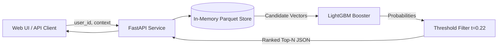

# 🛒 CartPulse: Real-Time Grocery Basket Recommender Microservice

[](https://github.com/veereshmulge0808/Instacart-recommender/actions)
[](https://Instacart-recommender.onrender.com)
[](https://Instacart-recommender.onrender.com/docs)
[](https://hub.docker.com)

An end-to-end machine learning system trained on 32+ million grocery transactions from the Instacart dataset. Framed as a supervised classification and candidate ranking problem, CartPulse predicts and ranks catalog items that a customer is most likely to repurchase in their next order.

---

## System Architecture



---

## Key Engineering Highlights

* **Data Engineering at Scale:** Merged 6 relational tables across 32M+ interaction logs using custom numeric downcasting to cut memory overhead by **~70%**.
* **Leak-Free Validation:** Partitioned 131,000+ users via an 80/20 customer-level split rather than random row shuffling to prevent cross-order data leakage.
* **Metric Optimization:** Tuned classification decision thresholds ($0.12 \le t \le 0.36$) under extreme class imbalance (~9.8% positive rate), achieving a peak **validation $F_1$-score of 0.4425**.
* **Low-Latency Serving:** Decoupled offline feature engineering from online inference using Snappy-compressed columnar Parquet stores and an asynchronous FastAPI backend (**<25ms inference latency**).
* **Production CI/CD & Containerization:** Packaged in a slim Debian Docker container with OpenMP multi-threading, automated `pytest` verification via GitHub Actions, and live hosting on Render.

---

## Quickstart

### Run with Docker
```bash
docker build -t Instacart-recommender:v1 .
docker run -p 8000:8000 Instacart-recommender:v1
```
Open `http://localhost:8000` for the interactive dashboard or `http://localhost:8000/docs` for OpenAPI Swagger documentation.
